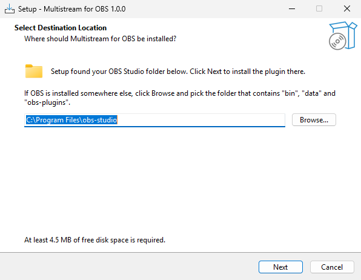
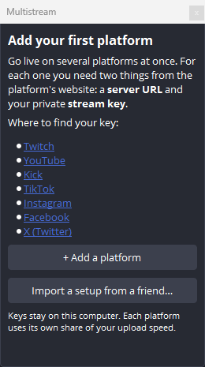
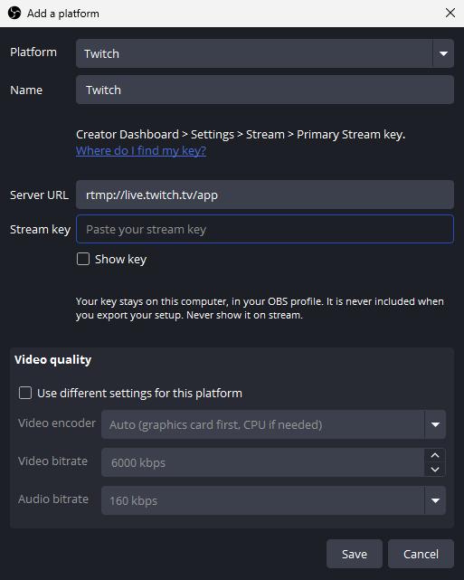
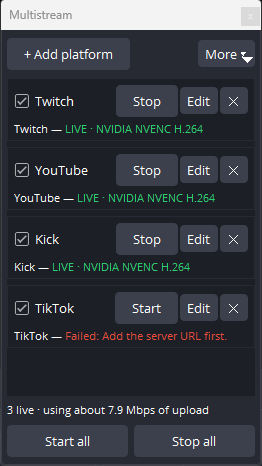

# How to install Multistream for OBS

Multistream adds a panel to OBS that sends your stream to several platforms at the same time (Twitch, YouTube, Kick, TikTok and more).

**You need:** OBS Studio 31 or newer. Get it free at [obsproject.com](https://obsproject.com/download).

---

## 1. Install it

**Close OBS first.** Then choose your computer:

### Windows

1. Download **`obs-multistream-…-windows-x64-installer.exe`**.
2. Double-click it. If Windows shows "Windows protected your PC", click **More info → Run anyway**.
   (This shows up because the file isn't signed with a paid certificate.)
3. The installer finds your OBS folder by itself. Click **Next**, then **Install**.

*No installer?* Use the **`…-windows-x64.zip`**. Copy its `obs-plugins` and `data` folders into `C:\Program Files\obs-studio`. The zip has a step-by-step text file.

### Mac

1. Download **`obs-multistream-…-macos-universal.pkg`**.
2. **Right-click** the file and choose **Open**, then click **Open** again.
   On newer macOS, if there's no Open button: click **Done**, then go to **System Settings → Privacy & Security**, scroll down, and click **Open Anyway** next to the Multistream message.
   (This is needed because the package isn't signed by a paid Apple developer account.)
3. Click through the installer.

### Linux

- **Ubuntu / Debian:** double-click **`obs-multistream-…-x86_64-linux-gnu.deb`**, or run `sudo apt install ./obs-multistream-*.deb`.
- **Any other distro:** unpack **`obs-multistream-…-linux-x86_64.tar.gz`** and run `./install.sh` (no password needed).
- The Flatpak version of OBS can't load this plugin.

---

## 2. Add your first platform

Open OBS. The **Multistream** panel opens by itself the first time. Later you can find it under **Docks → Multistream**. You can drag it into the OBS window.

1. Click **+ Add a platform**.
2. Pick the platform (for example Twitch).
3. Paste your **stream key**. Click **Where do I find my key?** to open the right page on that platform's website.
   Kick, TikTok, Instagram and X also give you a **server URL**. Paste that too.
4. Click **Save**. Do the same for each platform.

> 🔒 **Your stream key is like a password.** It stays on your computer only. Never show it on stream, never send it to anyone.
> TikTok and Instagram give you a **new key every time** you go live. Paste the new one in before each stream.

---

## 3. Go live

Tick the platforms you want, then press **Start all**. Each one turns green when it's **LIVE**. Press **Stop all** when you're done.

- Each platform uses its own share of your **upload** speed. Example: 3 platforms at 6000 kbps needs about 20 Mbps of upload.
- Want OBS's own **Start Streaming** button to start them too? Open **More → Also start/stop with OBS's Start Streaming button**.

---

## Share your setup with a friend (no keys)

**More → Export my setup (no keys)** saves a small file with your platform list and quality settings. **It never contains stream keys.** Your friend uses **More → Import a setup…**, then clicks **Edit** on each platform and pastes their own key.

---

## Remove it

Close OBS first.

- **Windows:** **Settings → Apps → Installed apps → Multistream for OBS → Uninstall**. It asks whether to also delete your saved platforms and keys.
- **Mac:** delete `/Library/Application Support/obs-studio/plugins/obs-multistream.plugin`. To also remove your saved platforms and keys, delete `obs-multistream.json` in each folder under `~/Library/Application Support/obs-studio/basic/profiles/`.
- **Linux:** `sudo apt remove obs-multistream` (.deb), or run `./uninstall.sh` (.tar.gz).

---

## Something wrong?

| You see | What to do |
|---|---|
| "Multistream needs a newer OBS" | Update OBS from obsproject.com. Your scenes are kept. |
| "The platform refused the stream key" | Copy a fresh key from the platform's website and paste it with **Edit**. |
| "Couldn't connect" | Check the server URL and your internet connection. |
| "Skipped: needs your stream key" | Click **Edit** and paste your key. |
| No Multistream panel | **Docks → Multistream**. |
| Stream stutters | Your upload is too slow for all platforms at once. Lower the bitrate (**More → Video quality**) or use fewer platforms. |
